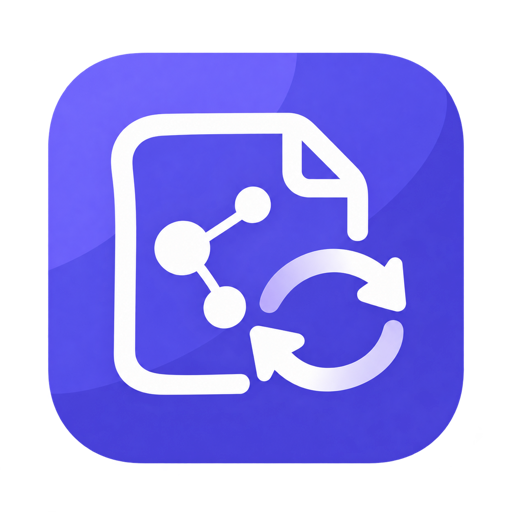

<p align="center">
  
</p>

<h1 align="center">ExcaliSync</h1>

<p align="center">
  A local-first file manager and GitHub sync companion for Excalidraw.
</p>

<p align="center">
  <a href="LICENSE"></a>
  
  
  
</p>

ExcaliSync adds a focused file-and-folder sidebar directly to [Excalidraw](https://excalidraw.com/). Organize drawings, switch between them without closing the sidebar, keep recoverable local copies, and optionally synchronize the same workspace between computers through a GitHub repository you control.

> [!NOTE]
> ExcaliSync is under active development and is currently installed from source. It is not yet published in browser extension stores.

## Why ExcaliSync?

Excalidraw is excellent for drawing, but a growing library of diagrams needs more structure. ExcaliSync supplies that missing workspace without replacing Excalidraw:

- **Organize naturally** with nested folders, search, pinning, custom ordering, drag and drop, import, rename, and trash recovery.
- **Work locally first** so every save reaches the browser before any network request.
- **Sync on your terms** to a private or public GitHub repository, with explicit Pull, Push, and Force push controls.
- **Move between computers** by connecting the same GitHub repository and pulling the existing library.
- **Recover older work** from the per-file GitHub version history or from the 30-day local trash.
- **Preserve embedded images** inside synchronized `.excalidraw` files.

## Highlights

| Workspace | Saving and recovery | GitHub sync |
| --- | --- | --- |
| Nested folders and tree view | Automatic, timed, or manual saving | Private or public repository |
| Drag-and-drop ordering | Browser recovery copy | Change-only commits |
| File/link import | Optional disk vault | Cross-machine Pull and Push |
| Fast in-place file switching | 30-day recoverable trash | Per-file version restore |
| Read-only share links | 7-day sanitized error logs | Optional automatic history squash |
| Five interface languages | Save and sync health indicators | Retry-safe conflict handling |

ExcaliSync supports English, Brazilian Portuguese, Spanish, French, and German. It selects the browser language on first use. Its default theme follows Excalidraw, with system, light, and dark modes also available.

## How it works

```text
Excalidraw scene
      │
      ▼
Browser workspace ──► Excalidraw-site recovery copy
      │
      ├─────────────► ~/.excalidraw-sync (optional native helper)
      │
      └─────────────► GitHub repository (optional)
```

The browser workspace is always written first and remains the offline working copy. GitHub becomes the shared cloud authority only when you enable it. A normal Push downloads the managed index, merges files and folders by stable ID and modification time, applies deletion tombstones, and uploads only actual differences.

## Install from source

### Requirements

- Node.js 18 or newer
- npm
- A Chromium browser, Firefox, or Safari with Xcode

Clone and build:

```bash
git clone https://github.com/thiagoheron1/Excalidraw-Sync.git
cd Excalidraw-Sync
npm ci
npm test
npm run check
npm run build
```

The build creates:

- `dist/chrome` for Chrome, Edge, Opera, Brave, and other Chromium browsers
- `dist/firefox` for Firefox
- packaged ZIP files for both targets

### Chrome, Edge, Opera, or Brave

1. Open the browser extension page:
   - Chrome or Brave: `chrome://extensions`
   - Edge: `edge://extensions`
   - Opera: `opera://extensions`
2. Enable **Developer mode**.
3. Choose **Load unpacked**.
4. Select the generated `dist/chrome` folder.
5. Open [excalidraw.com](https://excalidraw.com/).

### Firefox

1. Open `about:debugging#/runtime/this-firefox`.
2. Choose **Load Temporary Add-on**.
3. Select `dist/firefox/manifest.json`.
4. Open [excalidraw.com](https://excalidraw.com/).

Temporary Firefox add-ons are removed when Firefox restarts. Permanent distribution requires a signed add-on package.

### Safari

Safari Web Extensions are distributed through an Xcode app target:

```bash
npm run build:safari
```

Open the generated Xcode project, choose your signing team and bundle identifier, then run the containing app.

## First use

1. Open [Excalidraw](https://excalidraw.com/).
2. Select the **ExcaliSync** launcher near the upper-right of the canvas. On a fresh installation it pulses until its first use.
3. Create a folder and a drawing, or import an existing `.excalidraw` file.
4. Draw normally. ExcaliSync saves the active scene according to your autosave preference.
5. Select another drawing in the sidebar. The current drawing is saved first, the new scene opens in place, and the sidebar stays visible.
6. Open **Settings** to choose saving, appearance, local storage, and GitHub options. Settings save automatically.

You can drag the launcher to another safe position on the canvas or move it with **Alt + Arrow keys**. If you hide the launcher or collapsed sidebar, select ExcaliSync from the browser toolbar to open it again.

### Everyday controls

- **New file / New folder** creates content in the selected folder.
- **Search** filters files and folders.
- **Sync now** saves all pending work and synchronizes GitHub when connected.
- **Cmd + S** on macOS or **Ctrl + S** elsewhere triggers a local save and GitHub sync.
- A file's **history** icon opens its GitHub versions.
- A file's **link** icon uses Excalidraw's read-only Shareable Link export and copies it.
- Folder menus provide creation, import, rename, move, ordering, and deletion actions.

Save warnings stay neutral during the configured autosave window plus a 30-second grace period. A delayed item turns yellow, and red is reserved for the later stale limit configured in Settings. Hover or focus the warning icon to see the reason immediately.

## GitHub synchronization

GitHub sync is optional. ExcaliSync uses OAuth Device Flow, requests the `repo` scope so private repositories can work, and does not require a client secret.

### Create a GitHub OAuth App

Open **GitHub → Settings → Developer settings → OAuth Apps → New OAuth App**, then fill the form as follows:

| GitHub field | What to enter |
| --- | --- |
| **Application name** | `ExcaliSync`, or another name you recognize |
| **Homepage URL** | `https://excalidraw.com/` |
| **Application description** | Optional: `Sync Excalidraw drawings to my GitHub repository.` |
| **Redirect URI** | `https://excalidraw.com/` — GitHub requires the field even though Device Flow does not redirect to it |
| **Allow wildcard matching** | Leave disabled |
| **Enable Device Flow** | Enable |
| **Expire user access tokens** | Keep enabled |

Then:

1. Select **Register application**.
2. Copy the **Client ID**.
3. Do **not** generate or paste a client secret into ExcaliSync.
4. In ExcaliSync, open **Settings → GitHub**.
5. Paste the Client ID and choose a repository name, visibility, and root folder.
6. Select **Connect**.
7. Enter the displayed one-time code on the GitHub page that opens.
8. Return to Excalidraw. ExcaliSync creates the repository during the first synchronization if it does not already exist.

The same setup guide is built into the GitHub Settings tab. See GitHub's official documentation for [creating an OAuth App](https://docs.github.com/en/apps/oauth-apps/building-oauth-apps/creating-an-oauth-app) and [authorizing with Device Flow](https://docs.github.com/en/apps/oauth-apps/building-oauth-apps/authorizing-oauth-apps#device-flow).

> [!IMPORTANT]
> A Client ID is public and cannot be meaningfully encrypted. A client secret must never be bundled in a browser extension. Access and refresh tokens are private: ExcaliSync keeps them in extension-owned storage and never writes them to drawings, Git commits, page DOM, or diagnostics.

### Pull, Push, and Force push

| Action | Behavior |
| --- | --- |
| **Pull** | Replaces this browser's local library with the GitHub workspace after confirmation. |
| **Push** | Downloads GitHub first, merges compatible changes, then uploads only differences after confirmation. |
| **Force push** | Makes this browser's library authoritative for ExcaliSync-managed paths. Requires explicit typed confirmation. |

Files edited independently on different computers merge individually by their stable IDs and newest modification time. Deletion tombstones remain during the 30-day trash period so an offline computer does not recreate deleted content when it reconnects.

To use another computer:

1. Install ExcaliSync there.
2. Connect the same GitHub account.
3. Enter the same OAuth Client ID, repository name, and root folder.
4. Use **Pull** when the GitHub workspace should initialize that browser.

### Version history

Every synchronized file has a history icon. Select it to:

1. List commits that changed that specific file.
2. Preview a historical version on the canvas without modifying the saved file.
3. Confirm **Restore this version** when you want to make that scene current.

The restored scene is saved as a new current change, preserving the normal synchronization flow.

### Automatic history squash

ExcaliSync can replace the default branch's older history with one baseline commit while preserving every current repository file. It is enabled by default every 30 days and can be changed from 1 to 365 days.

Squashing permanently resets the repository's commit ancestry and starts per-file history again from the new baseline. Traditional Git clones may need to reset or clone again. Disable this option if long-term Git commit history matters more than keeping the repository compact.

## Local storage and recovery

ExcaliSync maintains:

1. The extension's browser workspace.
2. A recovery copy in IndexedDB under the `excalidraw.com` origin.
3. Optionally, ordinary files under `~/.excalidraw-sync` through the native helper.

The browser recovery copy allows a newly reinstalled extension to rediscover its library when site data still exists. It is best effort: clearing Excalidraw site data, deleting the browser profile, private browsing, or browser cleanup can remove it.

### Install the macOS disk helper

Browser extensions cannot write arbitrary home-directory files directly. After loading the unpacked Chromium build, copy its extension ID from the extensions page and run:

```bash
./native-host/install-macos.sh YOUR_32_CHARACTER_EXTENSION_ID
```

Reload the extension. The helper is restricted to `~/.excalidraw-sync`, stores no OAuth credentials, and provides:

- drawing and folder copies in the local vault
- `.trash` backups retained for 30 days
- sanitized error-only `.logs` retained for 7 days

Open **Settings → Storage → Open vault** to reveal the folder in Finder. Without the helper, the same control opens the browser recovery vault.

### Trash and deletion

Deleting a file or folder requires confirmation. On touch devices, swiping left only requests deletion; it never deletes immediately. Keyboard and desktop users always have an accessible delete control.

Deleted items disappear from the active library but preserve their original names and tree structure in **Settings → Trash** for 30 days. You can restore an individual file or an entire folder. **Delete files** is a separate destructive action that requires typing `delete` exactly.

## Privacy and security

- Drawings remain local unless you explicitly connect GitHub.
- GitHub requests use HTTPS.
- Credentials are never included in exported diagrams, repository content, or diagnostic logs.
- Error logs sanitize token-like values before writing.
- The extension does not include analytics or advertising.
- No browser extension can protect secrets from a compromised operating system, browser profile, or privileged malicious extension.

Read [PRIVACY.md](PRIVACY.md) for data handling and [SECURITY.md](SECURITY.md) for the threat model and responsible disclosure guidance.

## Browser support

| Browser | Extension package | GitHub sync | Disk helper |
| --- | --- | --- | --- |
| Chrome / Edge / Opera / Brave | Chromium Manifest V3 | Yes | macOS |
| Firefox | Firefox Manifest V3-compatible build | Yes | Not currently packaged |
| Safari | Xcode conversion | Yes | Not currently packaged |

Browser-store review, signing, and distribution are still required before production installation.

## Development

```bash
npm ci
npm test
npm run check
npm run build
```

The project intentionally uses a small, dependency-light architecture:

| Path | Responsibility |
| --- | --- |
| `content.js` | Shadow DOM sidebar, Excalidraw integration, save orchestration, and UI |
| `background.js` | OAuth, GitHub API operations, token isolation, and synchronization |
| `shared/core.js` | Workspace transforms, hashing, paths, merging, and retention rules |
| `shared/ui-events.js` | Testable interaction and recovery behavior |
| `shared/i18n.js` | Interface translations |
| `native-host/` | Optional local-disk bridge |
| `test/` | Node-based regression suite |

Every reproduced bug fix must include a focused automated regression test that simulates the original failure. See [AGENTS.md](AGENTS.md) for the repository's interaction and testing rules.

## Contributing

Contributions are welcome:

1. Search the [existing issues](https://github.com/thiagoheron1/Excalidraw-Sync/issues).
2. Open an issue for significant behavior or design changes before investing in a large implementation.
3. Create a focused branch and keep unrelated changes separate.
4. Add or update tests for behavior changes.
5. Run `npm test`, `npm run check`, and `npm run build`.
6. Open a pull request that explains the user-facing change and its verification.

Useful contribution areas include browser-specific validation, accessibility, translations, native helpers for additional operating systems, performance, and security review.

## License

ExcaliSync is available under the [MIT License](LICENSE).

ExcaliSync is an independent open-source project and is not affiliated with or endorsed by Excalidraw or GitHub. Excalidraw and GitHub are trademarks of their respective owners.
